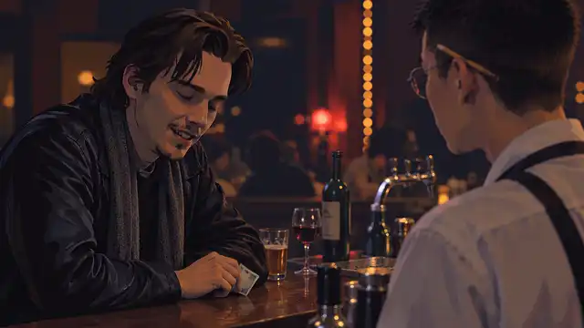

# Films

Short films and scenes by Avijit Thawani. Each folder holds one finished cut with its subtitles and poster.
The files are served by GitHub Pages so other sites (such as my portfolio) can play them directly.

## Six Months Later: the bar (2026, 28 s)

[Watch with sound](https://avijit-thawani.github.io/films/six-months-later/bar.mp4) ·
[subtitles (.srt)](six-months-later/bar.srt)

Fan fiction after *Before Sunrise* (1995). In the film, Jesse talks a Vienna bartender into giving him a bottle
of wine on a promise to pay later. In a
[2013 Reddit AMA](https://www.reddit.com/r/IAmA/comments/1g9vm5/comment/cai5xry/), Ethan Hawke said that
Jesse went back six months later to pay, found the bartender no longer worked there, and left someone else a
tip. This scene is that visit.

The picture and voices are AI-generated: rotoscope-style keyframes (GPT Image), then speaking clips (Veo 3.1),
cut together with split edits. The characters are drawn as original characters. This is an unofficial,
non-commercial fan work, not affiliated with the film or its makers.

| File | What |
|---|---|
| `six-months-later/bar.mp4` | 1920x1080, 24 fps, English subtitles burned in |
| `six-months-later/bar.srt`, `bar.vtt` | The same subtitles as text |
| `six-months-later/poster.jpg` | Poster frame |
| `six-months-later/preview.webp` | Silent loop for this README |
